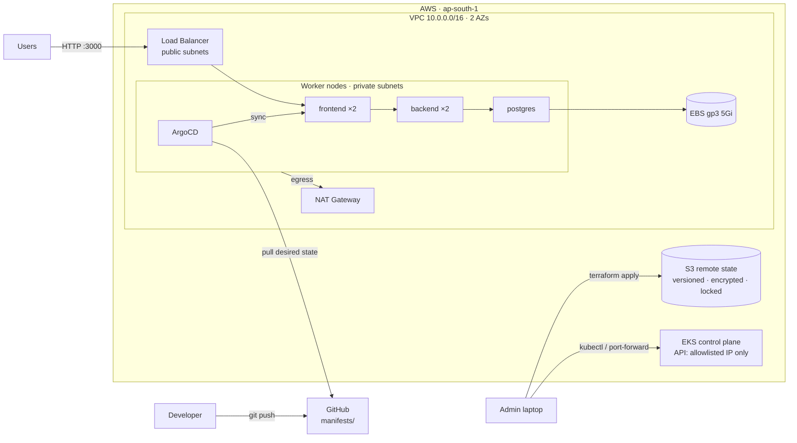
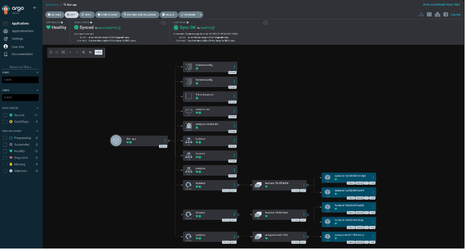
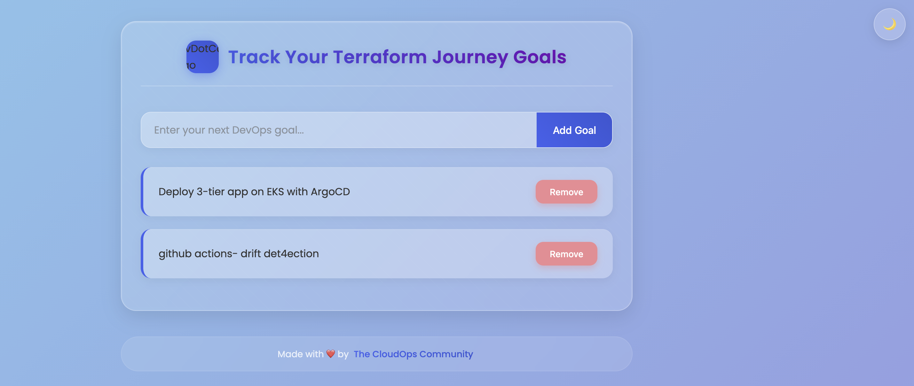
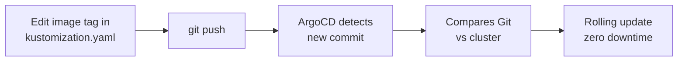
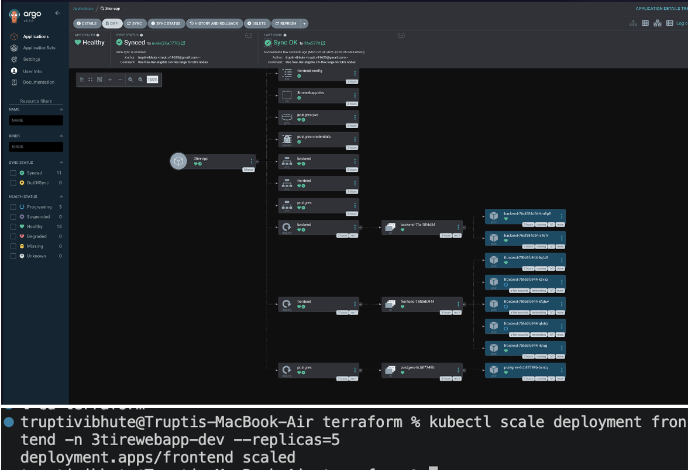

# GitOps on AWS EKS with Terraform & ArgoCD


Terraform provisions a production-style Amazon EKS platform (VPC, cluster, storage, ArgoCD). ArgoCD then continuously deploys a 3-tier web app from this Git repository.

**Git is the single source of truth.** To release, change an image tag in Git and push. To roll back, revert the commit. If someone changes the cluster by hand, ArgoCD detects the drift and restores the state defined in Git within seconds.

The app is a Goal Tracker: a Node.js frontend, a Go REST API and PostgreSQL. Its source code lives in [3-tier-architecture-aws-terraform](https://github.com/trupti-vibhute/3-tier-architecture-aws-terraform).

---

## Architecture





### What is exposed

| Component | Reachable from | Access |
|---|---|---|
| Frontend (Goal Tracker UI) | Internet | AWS load balancer on port `3000` |
| Kubernetes API server | Allowlisted admin IP only, plus the private VPC endpoint | IAM token → EKS access entry → RBAC |
| ArgoCD UI | Admin laptop only | `kubectl port-forward`; no public address |
| Backend API, PostgreSQL | Inside the cluster only | `ClusterIP` services |
| Worker nodes | Nobody directly | Private subnets, no public IPs, no SSH |

---

## Tech stack

| Area | Tools |
|---|---|
| Cloud | AWS: VPC, NAT Gateway, ELB, EC2, EBS, IAM, EKS, S3, CloudTrail |
| Infrastructure as Code | Terraform with official `vpc`, `eks` and `iam` modules |
| Orchestration | Kubernetes 1.35 (EKS, Amazon Linux 2023 nodes) |
| GitOps / CD | ArgoCD with automated sync, prune and self-heal |
| Configuration | Kustomize (image tags, replicas) |
| Storage | EBS CSI driver with IRSA, encrypted `gp3` StorageClass |
| Containers | Docker images on Docker Hub |

---

## Repository structure

```
.
├── bootstrap/             # One-time: S3 bucket for Terraform remote state
│   └── main.tf
├── terraform/             # The platform
│   ├── backend.tf         # S3 remote state with native locking
│   ├── terraform.tf       # Terraform + provider versions
│   ├── providers.tf       # AWS, Kubernetes and kubectl providers (EKS auth)
│   ├── variables.tf
│   ├── main.tf            # VPC → EKS → EBS CSI → ArgoCD
│   ├── outputs.tf         # Helper commands (kubeconfig, ArgoCD login, app URL)
│   └── terraform.tfvars.example
└── manifests/             # Desired state of the app, synced by ArgoCD
    ├── kustomization.yaml # Image tags and replica counts: edit this to release
    ├── namespace.yaml
    ├── secret.yaml
    ├── postgres.yaml      # Deployment + PVC + Service
    ├── backend.yaml       # Deployment + ConfigMap + Service
    ├── frontend.yaml      # Deployment + ConfigMap + LoadBalancer Service
    └── argocd-app.yaml    # ArgoCD Application (applied by Terraform)
```

**Who owns what:** Terraform owns the infrastructure, including ArgoCD and the `Application` object. ArgoCD owns everything in `manifests/`. The two tools never manage the same resource.

---

## Deploy it

### Prerequisites
- AWS account and the AWS CLI, configured with admin credentials
- Terraform ≥ 1.10, kubectl

### 1. Create the remote state bucket (one time)
```bash
cd bootstrap
terraform init && terraform apply
```
Copy the `state_bucket` output into `bucket` in `terraform/backend.tf`.

### 2. Allowlist your IP for the Kubernetes API
```bash
cd ../terraform
cp terraform.tfvars.example terraform.tfvars
curl -s https://checkip.amazonaws.com    # put this in terraform.tfvars as x.x.x.x/32
```

### 3. Provision the platform (~20 min)
```bash
terraform init
terraform plan -out=tfplan
terraform apply tfplan
```

### 4. Connect and check
```bash
aws eks update-kubeconfig --region ap-south-1 --name gitops-eks-cluster
kubectl get nodes
kubectl get application -n argocd          # 3tier-app   Synced   Healthy
kubectl get pods -n 3tirewebapp-dev
```

### 5. Open the app
```bash
kubectl get svc frontend -n 3tirewebapp-dev \
  -o jsonpath='{.status.loadBalancer.ingress[0].hostname}'
```
Open `http://<hostname>:3000`. DNS can take a few minutes to resolve.



### 6. Open the ArgoCD UI
```bash
kubectl -n argocd get secret argocd-initial-admin-secret \
  -o jsonpath='{.data.password}' | base64 -d; echo
kubectl port-forward svc/argocd-server -n argocd 8080:443
```
Open https://localhost:8080 and log in as `admin`.

---

## GitOps workflow



| Action | How |
|---|---|
| Release a new version | Change `newTag` in `manifests/kustomization.yaml`, then commit and push |
| Scale | Change `replicas` in `kustomization.yaml`, then commit and push |
| Roll back | `git revert <commit>` and push |
| Audit | `git log`, which records who changed what and when |

### Drift detection and self-healing
With `selfHeal: true` and `prune: true`, manual changes are reverted automatically:

```bash
kubectl scale deployment frontend -n 3tirewebapp-dev --replicas=5
kubectl get deploy frontend -n 3tirewebapp-dev -w    # back to 2 within seconds
```

Tested: a manual scale to 5 replicas was reverted to 2 in about 3 seconds (`OutOfSync → Synced`).



---

## Security design

- **API server not open to the internet.** The public endpoint accepts only an allowlisted CIDR, and nodes use the private endpoint. A validation rule rejects `0.0.0.0/0`.
- **Defence in depth on the API.** Requests pass the network allowlist, then IAM authentication, then EKS access entries, then Kubernetes RBAC.
- **Private worker nodes.** They run in private subnets with no public IPs and no SSH, and reach the internet outbound through NAT only.
- **Least-privilege IAM (IRSA).** Only the EBS CSI controller's service account can assume the EBS IAM role.
- **ArgoCD UI not exposed.** It's reachable only through an authenticated `kubectl port-forward`.
- **Encryption.** EBS volumes and the Terraform state are encrypted at rest. The state bucket enforces HTTPS, blocks public access and keeps every version.
- **Secrets stay out of the repo where it matters.** `terraform.tfvars` and state files are gitignored. The Postgres password in `secret.yaml` is a **demo value only** (see Roadmap).

---

## Design decisions

| Decision | Why |
|---|---|
| Separate Terraform and ArgoCD responsibilities | Infrastructure changes rarely and needs plan/review. App releases are frequent and should be pull-based. |
| ArgoCD installed by Terraform | One `terraform apply` produces a ready GitOps platform with a pinned ArgoCD version |
| `resources-finalizer` on the Application | On destroy, ArgoCD removes the load balancer and EBS volume first, so no orphaned AWS resources are left |
| S3 native state locking (`use_lockfile`) | No DynamoDB table needed with Terraform ≥ 1.10 |
| Single NAT Gateway | Cost trade-off for a dev environment. Production would use one per AZ. |
| `gp3` default StorageClass with `WaitForFirstConsumer` | Cheaper and faster than gp2. The volume is created in the same AZ as the pod. |
| `c7i-flex.large` nodes | Free-plan accounts can only launch free-tier-eligible types. It's equivalent to t3.medium with a higher pod limit. |

---

## Troubleshooting log

Real issues hit while building this:

| Problem | Root cause | Fix |
|---|---|---|
| Node group stuck in `CREATING`, then `CREATE_FAILED` | CloudTrail showed `RunInstances` failing: *instance type not eligible for Free Tier* | Switched to the free-tier-eligible `c7i-flex.large` |
| EKS 1.30 unavailable | Version past end of support | Upgraded to 1.35 |
| No AMI for the node group | Amazon Linux 2 AMIs aren't published for EKS 1.33+ | Switched to `AL2023_x86_64_STANDARD` |
| Backend `CrashLoopBackOff` on first deploy | Backend started before Postgres was ready | Readiness probes and restarts recovered it. An init container would be the long-term fix. |
| ArgoCD rejected the correct password | 5 failed attempts triggered ArgoCD's login rate limit | Waited out the lockout. Verified the password against the stored bcrypt hash. |

---

## Cost and cleanup

Running cost is roughly the EKS control plane + 2 nodes + NAT Gateway + load balancer. **Destroy when you're done:**

```bash
cd terraform
terraform destroy
```
The state bucket is protected by `prevent_destroy` and costs almost nothing. To remove it, delete that block and run `terraform destroy` in `bootstrap/` after emptying the bucket.

---

## Roadmap

- [ ] CI with GitHub Actions: `terraform fmt/validate`, tflint, Checkov, kubeconform
- [ ] Image pipeline: build → Trivy scan → push → automatic tag bump in `kustomization.yaml`
- [ ] Secrets via Sealed Secrets or External Secrets + AWS Secrets Manager
- [ ] NetworkPolicies (frontend → backend → postgres only) and a hardened `securityContext`
- [ ] Ingress (AWS Load Balancer Controller) with TLS
- [ ] Kustomize overlays for `dev` / `prod`
- [ ] Prometheus + Grafana monitoring
- [ ] Fully private API endpoint behind SSM or a VPN

---

*Built while following the [Terraform Full Course AWS](https://github.com/piyushsachdeva/Terraform-Full-Course-Aws) (Day 29), then extended with remote state, API endpoint restriction, Free-plan compatibility, EKS 1.35 / AL2023 and the documentation above.*
